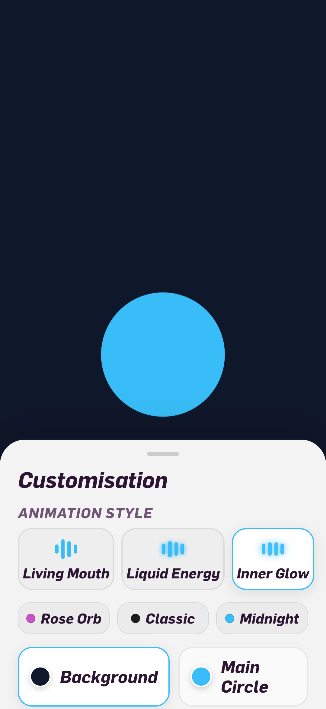
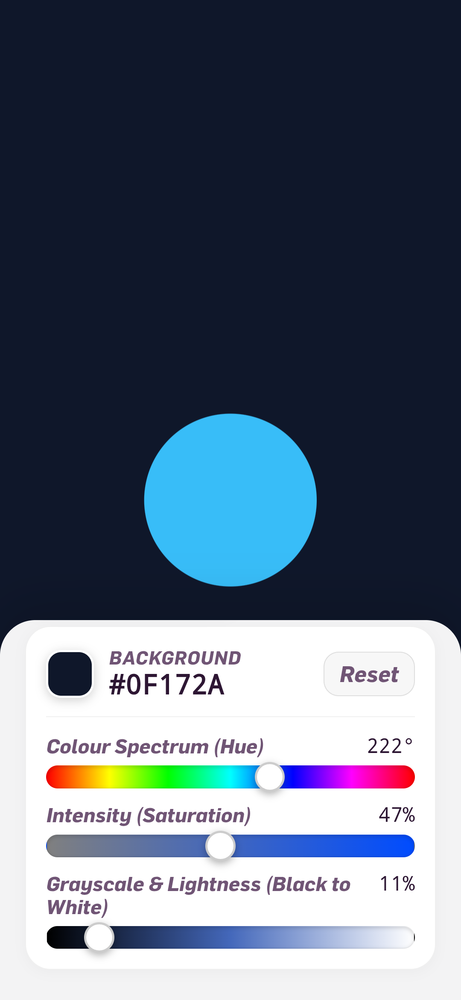
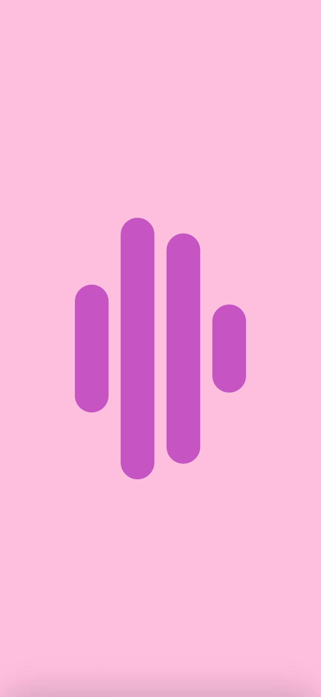
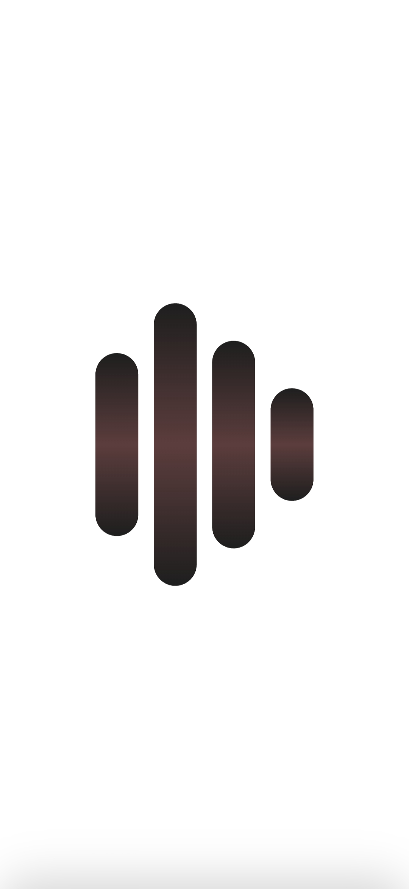
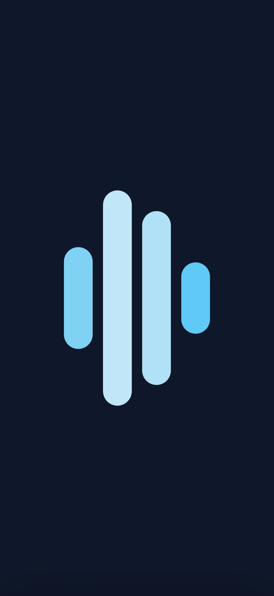

# Circle-voice-visualizer
A minimalist voice-reactive app where a simple circle moves with your voice. Explore fluid animations, customize colors, and enjoy a little motion with a personality of its own.

## Preview

  

    
    
    
    
    
  

A little circle that comes alive

What if a simple circle could respond to your voice?

This app turns your voice into motion, bringing a clean, minimal interface to life through smooth, voice-reactive animations. Speak, and watch the circle move and stretch with the rhythm of your voice.

Choose from different animation styles, experiment with colors, and create a look that feels right for you. Whether you prefer fluid, energetic movement or something soft and subtle, the experience adapts to the way you want it to feel.

Designed to keep distractions away, the app puts one thing at the center: the connection between your voice and what you see. No crowded interface, no unnecessary clutter. Just a little circle, a smooth response, and a playful sense of motion.

Simple to look at. Fun to bring to life. A tiny world of motion, shaped by your voice.
